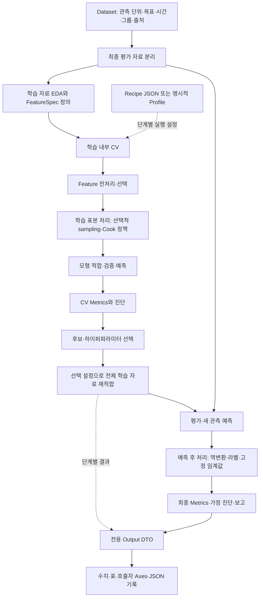

# 전체 분석 파이프라인과 Profile·DTO의 역할

이 저장소는 하나의 거대한 자동 실행기가 아니라, 분석 단계별 모듈을 조합하는 구조입니다. 아래가 지도 학습의 기본 흐름이며, 통계 추론·군집·생존분석·의사결정 최적화는 목적에 맞는 가지를 사용합니다. [전체 기능 카탈로그](ANALYSIS_CATALOG.md)는 268개 등록 모듈을 이 흐름에 맞춰 정리합니다.



화살표는 개념 흐름입니다. 실제 순서는 자료형과 알고리즘에 따라 달라집니다. 예를 들어 SMOTENC는 범주 열 위치를 보존하는 표현이 필요하고, 목표 변환은 X의 열 변환과 별도로 y에 적용합니다. Recipe/Profile은 모델 단계에만 존재하지 않고 전처리·선택·튜닝·지표·그림에도 각각 있습니다.

## 공통 기반의 역할

| 구성 | 제공 기능과 경계 | 실제 위치 |
| --- | --- | --- |
| Dataset | 자료 로드, 관측 단위·열·목표·시간·그룹·출처 정의. 공통 Dataset 클래스 하나를 강제하지 않습니다. 일반 파일은 `tabular-loader`로 읽고, UCI 공통 로더와 각 skeleton의 `load_data()`도 사용할 수 있습니다. 일반 로더는 학습용 전처리를 적합하지 않습니다. | [파일 로딩 명세](DATA_LOADING.md), [UCI 로더](../src/datasets/uci.py), [skeleton 안내](UCI_SKELETONS.md) |
| FeatureSpec | 그룹 이름, 대상 열 순서, 변환기, 활성 여부 선언. 타깃·ID·미래 정보를 자동으로 추측해 제외하는 객체는 아닙니다. | [FeatureSpec](../src/MachineLearning/base/feature.py) |
| Feature factory | 미적합 변환기를 구성해 CV마다 독립 적합할 수 있게 합니다. `build_feature_preprocessor()`는 여러 FeatureSpec을 결합합니다. | [Feature 처리](../src/Preprocessing/feature_pipeline.py) |
| Recipe | 평면 JSON의 반복 실행 설정. 데이터 행·적합 모델·예측 결과는 저장하지 않습니다. | [레시피 로더](../src/Recipes/loader.py), [설정 안내](RECIPES.md) |
| Profile | 기법별 타입 있는 설정 객체. JSON을 읽거나 직접 생성합니다. 로더가 필드/키를 검사하고 실행기가 기법별 값·입력 조건을 검사합니다. | 각 모듈의 `Input Profile` |
| Estimator / Transformer / Sampler | 각각 fit/predict, fit/transform, fit_resample을 담당하는 실행 객체. Pipeline/CV에서는 미적합·clone 가능한 객체를 사용합니다. | 각 도메인의 factory와 adapter |
| Public runner | 설정 해석·입력 검증·계산을 실행하고 전용 DTO를 반환합니다. 내부에서 분할하는 runner와 이미 분리된 학습 자료만 받는 runner가 함께 있습니다. | 각 모듈의 `run_*()` |
| Output DTO | 수치·배열·표·행/열 대응·설정·경고와 필요한 실행 객체를 묶는 결과 계약. 모든 단계가 같은 필드 집합을 쓰지는 않습니다. | [공통 OutputDTO](../src/output.py) 및 각 모듈의 전용 dataclass |
| Skeleton / 분석 코드 | 로드→설정→조합→실행→보고를 연결합니다. 업무상 채택 여부, 그림 배치, 보고서 해석은 이 계층의 책임입니다. | 각 도메인의 `skeleton/`, `기출문제/` |

`Basepipeline`은 sklearn 전처리→모델 연결 보조 객체입니다. 전체 분석 생명주기를 자동 관리하거나 sampling을 수행하는 객체는 아닙니다. CV에는 그 `.pipeline` 또는 직접 만든 sklearn/imblearn Pipeline을 전달합니다.

## 단계별 기능 명세

### 1. Dataset·평가 설계

분석 단위와 목표를 정하고 X와 y를 분리합니다. 시간·그룹·사건 여부·노출시간은 의미를 보존하고 Feature로 사용할지 따로 결정합니다. 외부 공식 train/test가 있으면 그 경계를 유지합니다.

| 설계 | 분리 원칙 | 현재 연결 기능 |
| --- | --- | --- |
| 독립 표본 분류 | 클래스 비율을 고려한 학습/평가 분리 | 지도 runner의 내부 분할 또는 외부 층화 분할+튜닝 모듈 |
| 독립 표본 회귀 | 원 반응 단위·같은 평가 행 유지 | 회귀 workflow·외부 Pipeline CV |
| 시간 자료 | 과거 학습→미래 검증→마지막 미래 평가 | `split='time'` 탐색, rolling ARIMA/SARIMA, TF 시계열 윈도 |
| 반복 고객·설비 등 그룹 | 같은 그룹이 학습/검증에 동시에 들어가지 않음 | 탐색 모듈의 `split='group'`와 `groups` |
| 검정·생존 추정 | 독립/대응/층화/중도절단 설계를 입력 계약에 반영 | 전용 검정·생존 runner; 예측 평가용 분할을 항상 요구하지 않음 |

내부 IID 분할 모델 runner에 시간·그룹 자료를 넣으면 설계가 바뀔 수 있습니다. 이때 분할 설정을 지원하는 탐색 모듈+미적합 estimator 또는 해당 도메인 runner를 사용합니다.

### 2. EDA·Feature 전처리

학습 자료의 결측·왜도·범주 빈도·집단별 분포·상관을 확인해 처리 후보를 정합니다. 수치 결측 대치·스케일·power, 범주 결측 대치·one-hot/ordinal/frequency를 Feature 그룹별 순서로 연결합니다. 상관행렬 변환은 계수 정리·쌍 추출·거리 표현을 제공하며 그 자체가 Feature 스케일 변환은 아닙니다.

전처리 factory는 아직 fit하지 않은 객체를 반환합니다. `run_numeric_*()`나 `run_feature_preprocessing()`은 전달한 X_train에 적합한 DTO를 반환하므로, 이 결과를 먼저 전체 학습 자료에서 만들고 그 안에서 CV를 돌리면 폴드 간 누수가 생깁니다. CV에는 factory가 만든 미적합 변환기를 넣습니다. 결측 대치는 가능한 경우 인코딩·거리·스케일 계산 전에 배치합니다.

RoPE는 시퀀스 임베딩 위치를 회전시키는 별도 표현 단계입니다. 일반 표의 범주 인코딩 대신 FeatureSpec에 섞지 않습니다.

### 3. 변수 선택·학습 표본 처리

| 기능 | 판단 기준·산출 | 적용 위치 |
| --- | --- | --- |
| Wrapper / 규제 선택 | CV 점수 또는 규제 계수 중요도로 선택 열 결정 | 학습/CV 안; 선택된 열을 새 입력에 동일 적용 |
| 순차 VIF | 중복 설명변수와 높은 공선성 후보 제거, 선택 이력 | 학습/CV 안; VIF는 관측 영향력 지표가 아님 |
| OLS AIC/BIC 선택 | 동일 행·같은 원 반응·full-rank OLS의 후진 선택 이력 | 학습/CV 안; 다른 반응 변환/가중 우도를 단순 비교하지 않음 |
| Cook 영향 관측 처리 | leverage·잔차 기반 영향도 flag, 명시적 제거 정책 | X/y 학습 행을 함께 처리하고 전처리 재적합; 평가 행은 유지 |
| Over/under sampling | 복제·합성·선택·중심점과 전후 클래스 수 | 분류 CV 학습 폴드 안의 imblearn Pipeline |

sampling은 예측 후 처리가 아닙니다. X/y의 학습 분포를 바꾸므로 모형 fit 전에 적용합니다. 수치 이웃 기법은 타당한 거리 표현이 필요하고 SMOTEN/SMOTENC는 범주 구조에 맞춰 사용합니다. 선택·전처리·sampling의 세부 순서는 모형과 자료에 따라 명시하고 전체 후보 Pipeline을 검증합니다.

Cook은 결측값을 찾는 지표가 아닙니다. 영향도가 높다는 이유만으로 오류 관측이라고 판단하지 않으며 기본은 flag입니다. 결측 처리와 영향 관측 정책은 별도 책임입니다.

### 4. Model·Recipe·Profile·튜닝

모형의 타깃 정의역과 출력 목적을 먼저 정합니다. 예측 회귀·분류 모델, OLS 추론, Bernoulli logit/Poisson/Gamma GLM, 명시 함수 비선형 회귀, 시간 모형의 진단 조건이 서로 다릅니다. 로지스틱 확률 회귀는 이진 분류이고 비선형 `logistic` 평균함수는 연속 S자 성장모형입니다.

설정은 다음 두 방식 중 하나로 전달합니다.

```python
from src.Recipes import load_profile
from src.stats.regression.ols import run_ols

# JSON → 일회성 재정의 → Profile → runner → 전용 DTO
profile = load_profile('regression-ols', overrides={'cov_type': 'HC3'})
result = run_ols(X_train, y_train, profile=profile)

# 동일 설정을 runner에서 해석하게 할 수도 있습니다.
result = run_ols(X_train, y_train, overrides={'cov_type': 'HC3'})
```

명시적 Profile과 recipe_path/task/overrides를 동시에 전달하지 않습니다. Profile은 결과 DTO나 적합 모형이 아니며, JSON 하나가 전처리부터 보고까지 자동 조립하는 전역 파이프라인 명세인 것도 아닙니다. 각 단계의 설정을 분석 코드가 연결합니다.

Grid·Random·Optuna는 학습 자료와 clone 가능한 estimator/Pipeline을 받아 같은 fold에서 후보를 비교합니다. `search_space`는 `model__C`처럼 실제 Pipeline 파라미터 이름을 사용합니다. DTO의 `best_score`는 CV 점수, `model`은 요청했을 때 전체 학습 자료에 재적합한 선택 모형입니다. `refit=False`이면 model은 None입니다. 음수 손실 scorer는 클수록 좋은 점수이므로 해석할 때 원 손실의 부호를 되돌립니다.

### 5. 예측 후 처리

| 처리 | 현재 제공 범위 | 호출자 결정 사항 |
| --- | --- | --- |
| 회귀 반응 역변환 | 목표 변환기·회귀 estimator/workflow가 원 단위 예측을 지원 | 단순 역변환과 조건부 평균 보정의 차이, 평가 단위 |
| 분류 라벨 복원 | 모델 adapter의 원 라벨·`classes` 순서 확률 | 양성 라벨과 비용에 맞는 임계값 |
| 임계값·비용 검토 | threshold 시각화와 ROC/PR·혼동행렬·수치 지표 | 임계값은 학습 내부 검증/별도 검증에서 선택하고 최종 평가에 고정 |
| 확률 보정 점검 | calibration 수치와 그림, Brier/log-loss | 보정기 적합을 자동 제공하지 않음; 별도 구현을 쓸 때 독립 보정 설계 필요 |
| 예측 구간 | OLS 평균 CI/새 관측 PI, 시간 모형 조건부 구간 | 모형별 가정·단위·포괄 확률과 해석 |

sampling으로 달라진 발생률의 확률이 자연 발생률에 자동 보정되는 것은 아닙니다. 현재 calibration 모듈은 예측 확률을 평가하며 새 calibration estimator를 학습하지 않습니다.

### 6. Metrics·진단·시각화·기록

| 목적 | 제공 기능 | 판단에 사용할 결과 |
| --- | --- | --- |
| 회귀 예측 | R²·RMSE·MAE·상대/로그/분위수 손실 | 같은 평가 행·원 반응 단위의 기준 대비 차이 |
| 분류 | confusion·precision/recall/F·ROC AUC·AP/PR 면적·Lift/Gain·확률 손실 | 순위·검출·확률·비용 목적을 구별 |
| 시계열 | horizon별 오차·MASE/RMSSE·naive 비교 | 시간 순서·동일 horizon·학습 기준 분모 |
| 군집 | silhouette·DB/CH, 정답 있는 경우 ARI/AMI/NMI 등 | 내부 분리와 외부 일치를 구별; 잡음 처리 정책 확인 |
| OLS 추론·진단 | 계수 t/묶음·전체 F, RESET/Rainbow, 잔차 정규·등분산·독립, VIF·Cook | 가정과 적합 좌표계를 확인; 사후 선택 조건부 추론 한계 |
| GLM·비선형 | 분포별 우도·계수·잔차·영향도 또는 모수 공분산 | OLS의 정규 잔차·F·일반 R²를 일괄 강제하지 않음 |

진단은 최종 단계에서 한 번 찍는 통과증이 아닙니다. 기준 모형→문제 확인→학습 내 처리 후보→CV 선택→새 진단의 반복입니다. 최종 평가로 처리 규칙을 반복 수정하면 그 자료는 더 이상 독립 최종 평가가 아닙니다.

그림 모듈은 호출자가 제공한 ax에서 작동합니다. `fig, axes = plt.subplots(...)`를 만든 뒤 각 축에 독립 모듈을 연결합니다. 예측 수치·진단 DTO를 다시 계산하지 않고 그림으로 전달할 수 있습니다. 모형별 실제 입력은 [회귀 명세](REGRESSION_DISTRIBUTION_MODULES.md)와 [EDA 명세](EDA_VISUALIZATION_MODULES.md)를 따릅니다.

## DTO로 단계 사이를 연결하는 방법

| 단계 DTO | 다음 단계에서 재사용하는 필드 | 경계 |
| --- | --- | --- |
| 전처리 | `preprocessed_feature`, `new_preprocessed_feature`, `output_features`, `transformer` | 이미 fit한 결과를 CV 바깥에서 공용하지 않음 |
| 표본 보완 | `X_resampled`, `y_resampled`, 클래스 수·`sample_indices` | 합성/중심점은 단일 원행에 대응하지 않아 indices=None |
| 튜닝 | `best_params`, `cv_results`, `folds`, `model` | 최종 test 성능과 별개 |
| 모델 | 예측·확률·클래스·분할 위치·적합 `model` 등 기법별 필드 | 분할과 새 입력 예측 지원을 기법별로 확인 |
| 진단 | 검정 통계량·p값·잔차·계수·영향도 등 | 독립/대응/시간·반응 좌표를 보존 |
| 평가 | `value`, `details`, `n_samples`, `warnings` | 평가 자료를 재적합하지 않음 |
| 시각화 | `data`, `artists`, `axes` 등 | figure 배치·저장은 호출자 책임 |

DTO는 단계 간 자동 호환을 보장하는 단일 데이터 버스가 아닙니다. 필드 이름과 차원은 전용 DTO를 확인해 명시적으로 전달합니다. 위 표는 공통적인 사용 패턴이며 정확한 이름은 [기능 카탈로그](ANALYSIS_CATALOG.md)와 상세 API를 확인합니다.

`to_dict()`는 기본적으로 model/transformer/sampler/axes 같은 실행 객체를 제외합니다. `to_json()`은 배열·표·희소행렬을 엄격 JSON으로 바꾸고 NaN/무한대는 null로 기록합니다. DataFrame은 index/columns/data를 보존합니다. 경고와 원 결과에서 미정의 사유를 확인해야 하며, 이 JSON으로 학습된 모형을 복원할 수는 없습니다. 출처·분할·각 단계 설정·선택 이력·평가 행·지표·판단 근거를 함께 기록합니다.

## 실행 가능한 분류 베이스라인

아래 예시는 수치 Feature 기준으로 데이터 분리→미적합 Feature 전처리→학습 내 sampling→Grid CV→최종 AUC를 연결합니다. 네트워크 없이 내장 데이터를 사용하며 저장소 루트에서 일반 모델·도메인·최적화 의존성을 설치한 환경에 실행합니다. 전체 코드는 [실행 예제](../examples/analysis_pipeline_baseline.py)에 있습니다.

```python
from examples.analysis_pipeline_baseline import main

result = main()
print(result['search'].best_params)
print(result['auc'].value)
print(result['auc'].to_json(indent=2))
```

예제의 sampling은 CV 학습 fold 안에 있으며, 모델의 predict/predict_proba에서는 실행되지 않습니다. 분류기 estimator는 sklearn의 LogisticRegression을 조합합니다. 추론용 `glm-logistic` runner를 CV estimator처럼 감싸 재분할하지 않습니다.

## 목적이 다른 분석의 가지

- **통계 검정·분포**: 관측 설계→Profile→전용 runner→추정/검정/확률 DTO→상황 해석. 예측 타깃·sampling·ROC가 필수 단계가 아닙니다.
- **군집·축소·연관·연결망**: 입력 정의→표현/척도→탐색 적합→구조·규칙·중심성→적절한 평가/그림. t-SNE/MDS와 밀도 군집의 현재 runner는 새 입력 predict/transform을 일괄 지원하지 않습니다.
- **생존분석**: 시간·사건·중도절단→KM/RMST/logrank/Cox→생존·HR·PH 진단. 우측 절단을 음성 클래스처럼 바꾸지 않습니다.
- **유전 알고리즘·생산 최적화**: 목적함수·제약·예산→탐색→실행가능 해·경과→가능한 경우 독립 최적해 검증. 하이퍼파라미터 CV와 다른 목적입니다.
