# 전체 시각화 PNG 예시

등록된 시각화 **61개 전체**의 기본 PNG와 분포별 GLM 변형5개, 영역별 subplot 조합14개를 제공합니다. 모든 자료는 고정 합성 자료이며 실제 업무 자료나 모형 우수성의 근거가 아닙니다.

각 모듈의 `if __name__ == "__main__":` 아래에서 자기 plot 함수로 PNG를 저장합니다. import와 일반 plot 호출에는 파일 저장 부작용이 없습니다. 색상으로 수치를 표시하는 예시는 호출자가 별도 cax를 만들어 색상 범례를 연결합니다. 그림 생성·저장은 예제 계층의 책임이며 plot 함수는 전달한 ax를 재사용합니다.

```bash
python -m src.Visualization.numeric.histogram
python -m src.Visualization.regression.glm_residuals --output-dir /tmp/adp-plots
python -m examples.visualization_gallery  # 전체 PNG·manifest·이 안내 재생성
python -m examples.visualization_gallery --check  # 파일·해시·등록부 누락 검사
```

기본 출력은 `docs/images/visualization/`입니다. 단일 모듈은 자기 PNG만 갱신하므로 출력 환경·예제 입력을 변경한 경우 전체 생성 명령으로 manifest와 안내도 갱신하세요. 한글은 저장소의 NanumGothic 폰트를 사용합니다.

[EDA 명세](EDA_VISUALIZATION_MODULES.md) · [회귀·분포 명세](REGRESSION_DISTRIBUTION_MODULES.md) · [이미지·설정·진단 manifest](images/visualization/manifest.json)

모수·조건·원 자료의 역할은 각 이미지 아래 자료 설명과 manifest의 note/parameters/diagnostics/warnings로 확인할 수 있습니다. 중요도·학습곡선·inertia·분산비·규칙 지표는 설명용 사전 계산 예시입니다. 회귀 비교는 같은 합성 자료의 동일4-fold 실제 CV, GA는 실제 소규모 탐색 이력입니다. GLM 잔차는 logistic/Poisson/Gamma와 Pearson/deviance를 각각 제공합니다.

## association

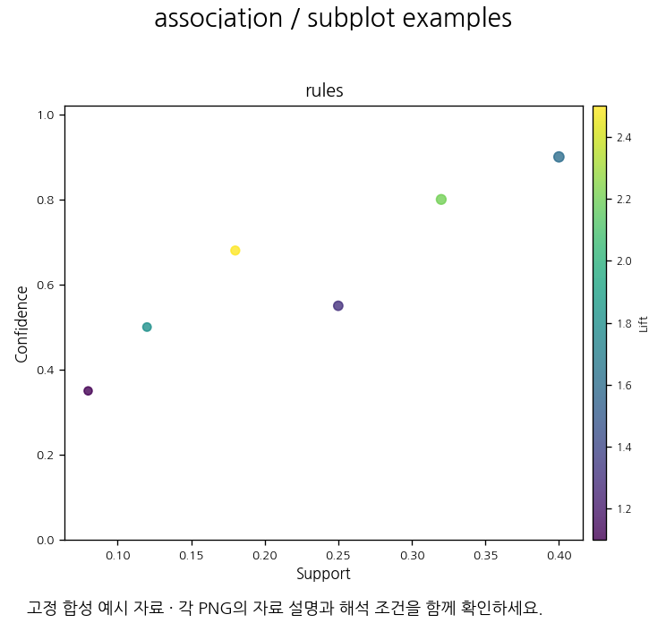

| 모듈·기능 | 개별 PNG |
| --- | --- |
| [`association.rules`](../src/Visualization/association/rules.py) — 빈도·조건부 확률·독립 대비 lift를 함께 비교해 규칙 검토 우선순위를 정합니다. | [기본 이미지](images/visualization/association/rules.png) |

## categorical

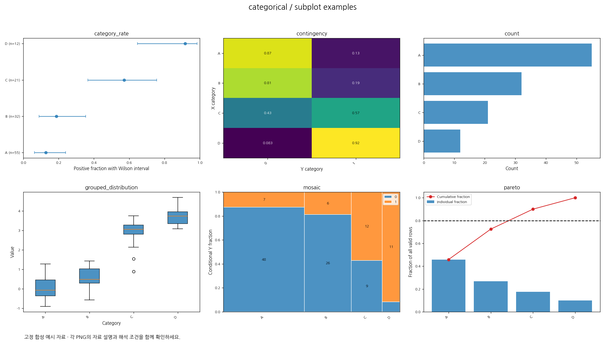

| 모듈·기능 | 개별 PNG |
| --- | --- |
| [`categorical.category_rate`](../src/Visualization/categorical/category_rate.py) — 범주별 발생률과 표본 수·불확실성으로 우선 검토 집단을 선택합니다. | [기본 이미지](images/visualization/categorical/category_rate.png) |
| [`categorical.contingency`](../src/Visualization/categorical/contingency.py) — 범주 조합의 집중·조건부 구성 차이와 희소 셀을 판단합니다. | [기본 이미지](images/visualization/categorical/contingency.png) |
| [`categorical.count`](../src/Visualization/categorical/count.py) — 클래스 불균형·희귀 범주·범주 통합 필요성을 판단합니다. | [기본 이미지](images/visualization/categorical/count.png) |
| [`categorical.grouped_distribution`](../src/Visualization/categorical/grouped_distribution.py) — 집단별 분포·중앙값·산포·소표본 차이를 비교합니다. | [기본 이미지](images/visualization/categorical/grouped_distribution.png) |
| [`categorical.mosaic`](../src/Visualization/categorical/mosaic.py) — 전체 구성과 범주 간 조건부 연관 패턴을 동시에 비교합니다. | [기본 이미지](images/visualization/categorical/mosaic.png) |
| [`categorical.pareto`](../src/Visualization/categorical/pareto.py) — 누적 기여를 기준으로 우선 검토할 범주를 선택합니다. | [기본 이미지](images/visualization/categorical/pareto.png) |

## classification

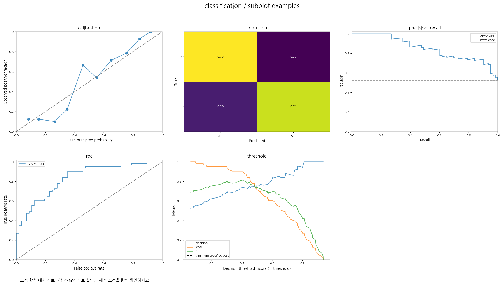

| 모듈·기능 | 개별 PNG |
| --- | --- |
| [`classification.calibration`](../src/Visualization/classification/calibration.py) — 확률의 과신·과소신과 실제 발생률의 일치를 점검합니다. | [기본 이미지](images/visualization/classification/calibration.png) |
| [`classification.confusion`](../src/Visualization/classification/confusion.py) — 어느 클래스 사이에서 오분류가 발생하는지 비교합니다. | [기본 이미지](images/visualization/classification/confusion.png) |
| [`classification.precision_recall`](../src/Visualization/classification/precision_recall.py) — 불균형 분류에서 재현율과 양성 예측 신뢰도를 비교합니다. | [기본 이미지](images/visualization/classification/precision_recall.png) |
| [`classification.roc`](../src/Visualization/classification/roc.py) — 분류 순위 성능과 위양성/민감도의 균형을 비교합니다. | [기본 이미지](images/visualization/classification/roc.png) |
| [`classification.threshold`](../src/Visualization/classification/threshold.py) — 비용과 precision/recall trade-off를 근거로 검증 자료의 임계값 후보를 선택합니다. | [기본 이미지](images/visualization/classification/threshold.png) |

## clustering

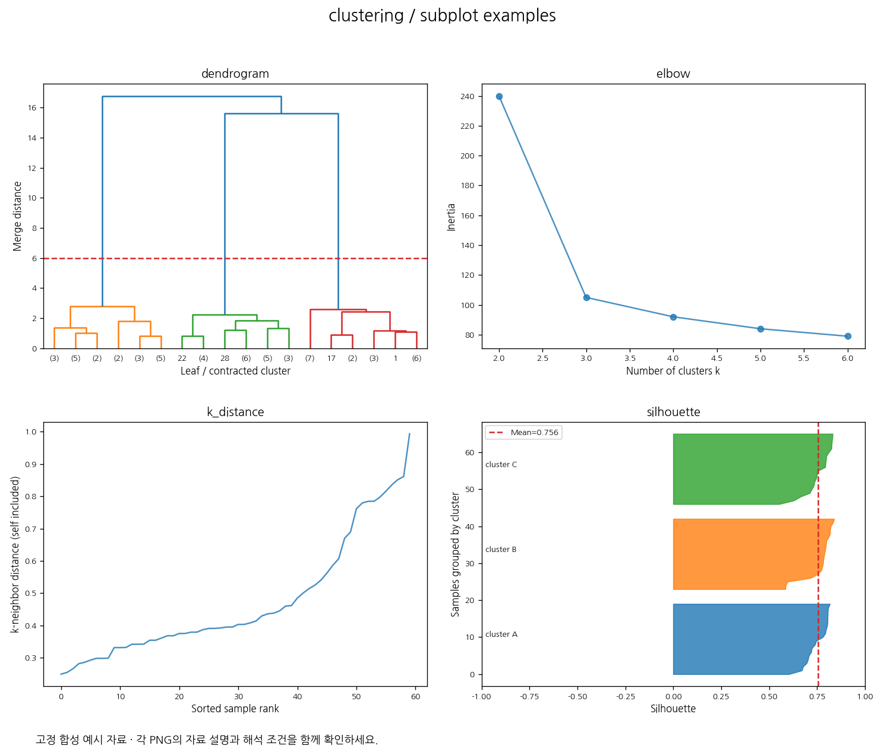

| 모듈·기능 | 개별 PNG |
| --- | --- |
| [`clustering.dendrogram`](../src/Visualization/clustering/dendrogram.py) — 계층 병합 거리와 절단 후보로 군집 구조를 검토합니다. | [기본 이미지](images/visualization/clustering/dendrogram.png) |
| [`clustering.elbow`](../src/Visualization/clustering/elbow.py) — 추가 군집 수에 따른 개선 규모를 비교합니다. 모델을 다시 적합하지 않습니다. | [기본 이미지](images/visualization/clustering/elbow.png) |
| [`clustering.k_distance`](../src/Visualization/clustering/k_distance.py) — 밀도 군집 eps 후보와 거리의 급격한 변화를 검토합니다. | [기본 이미지](images/visualization/clustering/k_distance.png) |
| [`clustering.silhouette`](../src/Visualization/clustering/silhouette.py) — 음의 silhouette·군집별 산포와 평균으로 군집 분리를 비교합니다. | [기본 이미지](images/visualization/clustering/silhouette.png) |

## decomposition

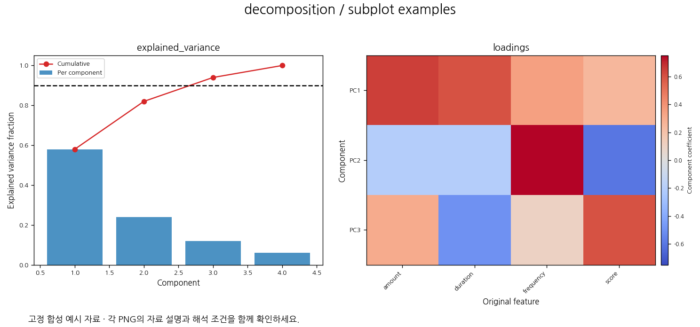

| 모듈·기능 | 개별 PNG |
| --- | --- |
| [`decomposition.explained_variance`](../src/Visualization/decomposition/explained_variance.py) — 목표 누적분산에 필요한 성분 수와 차원 축소 손실을 비교합니다. | [기본 이미지](images/visualization/decomposition/explained_variance.png) |
| [`decomposition.loadings`](../src/Visualization/decomposition/loadings.py) — 성분을 구성하는 원 Feature와 부호·기여 패턴을 해석합니다. | [기본 이미지](images/visualization/decomposition/loadings.png) |

## networks

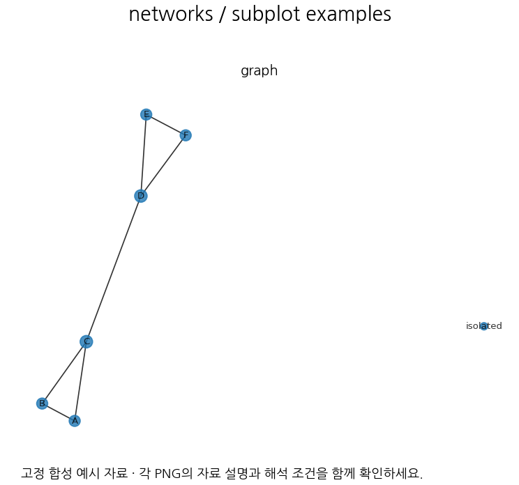

| 모듈·기능 | 개별 PNG |
| --- | --- |
| [`networks.graph`](../src/Visualization/networks/graph.py) — 연결 구조·분리 요소·허브 후보를 검토합니다. | [기본 이미지](images/visualization/networks/graph.png) |

## numeric

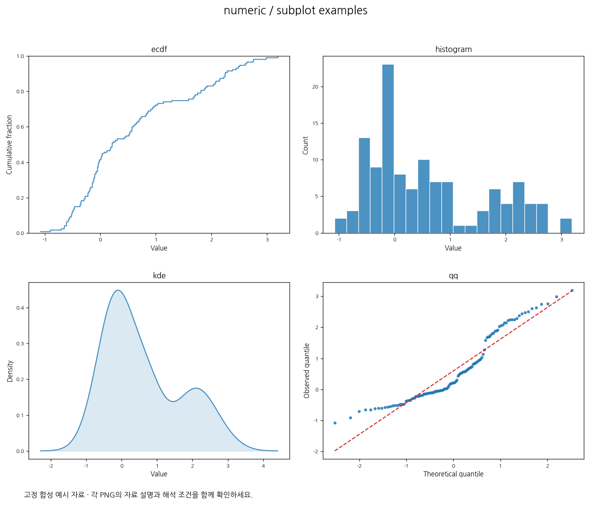

| 모듈·기능 | 개별 PNG |
| --- | --- |
| [`numeric.ecdf`](../src/Visualization/numeric/ecdf.py) — 특정 기준 이하의 비율과 분위수로 운영 기준을 검토합니다. | [기본 이미지](images/visualization/numeric/ecdf.png) |
| [`numeric.histogram`](../src/Visualization/numeric/histogram.py) — 왜도·다봉성·희귀 구간을 확인하고 변환/구간화 후보를 검토합니다. | [기본 이미지](images/visualization/numeric/histogram.png) |
| [`numeric.kde`](../src/Visualization/numeric/kde.py) — 히스토그램 구간 선택에 따른 착시를 비교하고 분포 구조를 탐색합니다. | [기본 이미지](images/visualization/numeric/kde.png) |
| [`numeric.qq`](../src/Visualization/numeric/qq.py) — 꼬리·분포 가정의 이탈을 점검해 통계 검정과 변환을 선택합니다. | [기본 이미지](images/visualization/numeric/qq.png) |

## optimization

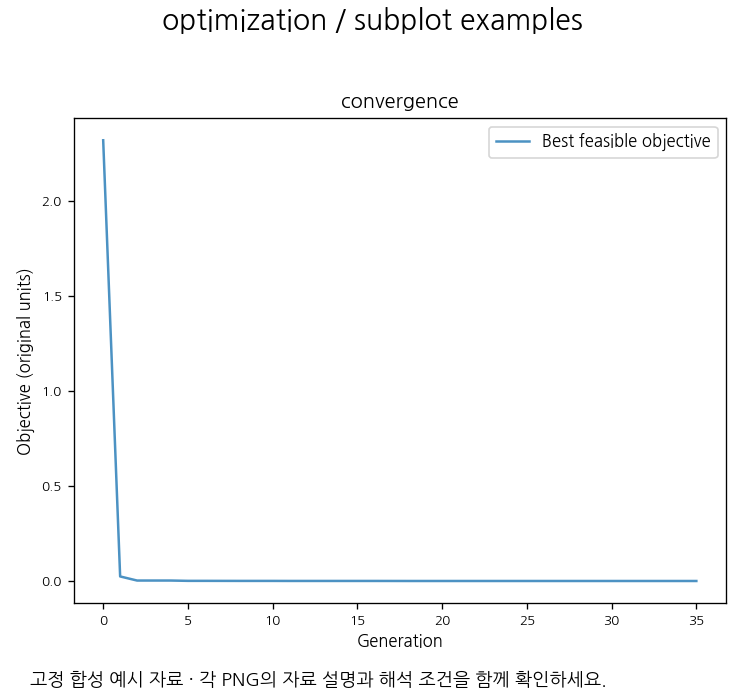

| 모듈·기능 | 개별 PNG |
| --- | --- |
| [`optimization.convergence`](../src/Visualization/optimization/convergence.py) — 유전 알고리즘 실행가능 최우수 목적값의 세대별 변화 | [기본 이미지](images/visualization/optimization/convergence.png) |

## qq

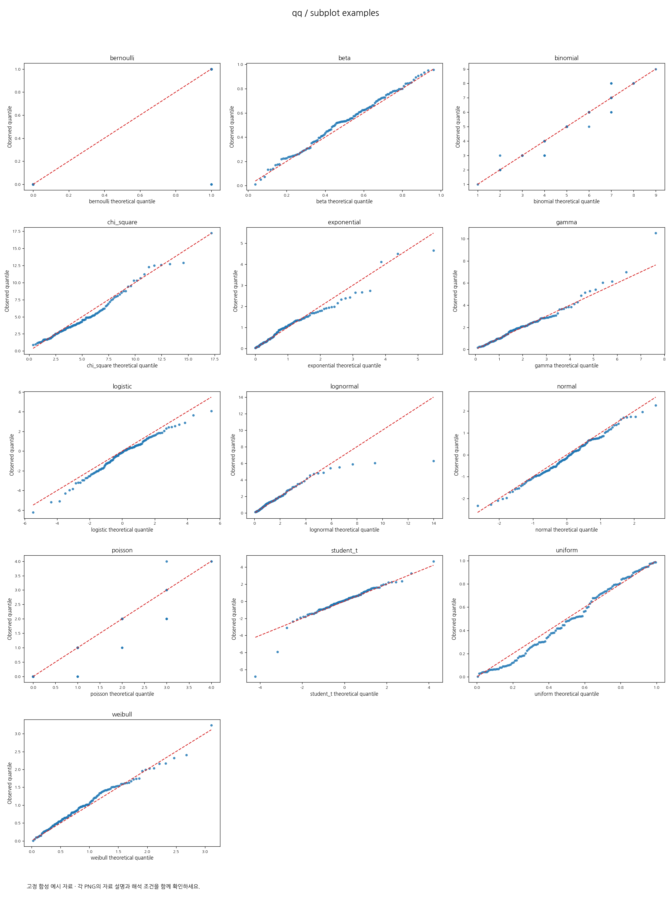

| 모듈·기능 | 개별 PNG |
| --- | --- |
| [`qq.bernoulli`](../src/Visualization/qq/bernoulli.py) — bernoulli 이산 분포 전용 Q-Q 비교 | [기본 이미지](images/visualization/qq/bernoulli.png) |
| [`qq.beta`](../src/Visualization/qq/beta.py) — beta 분포 전용 Q-Q 비교 | [기본 이미지](images/visualization/qq/beta.png) |
| [`qq.binomial`](../src/Visualization/qq/binomial.py) — binomial 이산 분포 전용 Q-Q 비교 | [기본 이미지](images/visualization/qq/binomial.png) |
| [`qq.chi_square`](../src/Visualization/qq/chi_square.py) — chi_square 분포 전용 Q-Q 비교 | [기본 이미지](images/visualization/qq/chi_square.png) |
| [`qq.exponential`](../src/Visualization/qq/exponential.py) — exponential 분포 전용 Q-Q 비교 | [기본 이미지](images/visualization/qq/exponential.png) |
| [`qq.gamma`](../src/Visualization/qq/gamma.py) — gamma 분포 전용 Q-Q 비교 | [기본 이미지](images/visualization/qq/gamma.png) |
| [`qq.logistic`](../src/Visualization/qq/logistic.py) — logistic 분포 전용 Q-Q 비교 | [기본 이미지](images/visualization/qq/logistic.png) |
| [`qq.lognormal`](../src/Visualization/qq/lognormal.py) — lognormal 분포 전용 Q-Q 비교 | [기본 이미지](images/visualization/qq/lognormal.png) |
| [`qq.normal`](../src/Visualization/qq/normal.py) — normal 분포 전용 Q-Q 비교 | [기본 이미지](images/visualization/qq/normal.png) |
| [`qq.poisson`](../src/Visualization/qq/poisson.py) — poisson 이산 분포 전용 Q-Q 비교 | [기본 이미지](images/visualization/qq/poisson.png) |
| [`qq.student_t`](../src/Visualization/qq/student_t.py) — student_t 분포 전용 Q-Q 비교 | [기본 이미지](images/visualization/qq/student_t.png) |
| [`qq.uniform`](../src/Visualization/qq/uniform.py) — uniform 분포 전용 Q-Q 비교 | [기본 이미지](images/visualization/qq/uniform.png) |
| [`qq.weibull`](../src/Visualization/qq/weibull.py) — weibull 분포 전용 Q-Q 비교 | [기본 이미지](images/visualization/qq/weibull.png) |

## quality

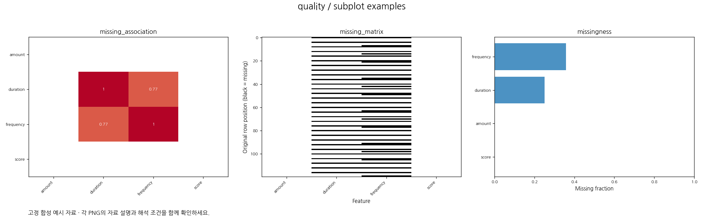

| 모듈·기능 | 개별 PNG |
| --- | --- |
| [`quality.missing_association`](../src/Visualization/quality/missing_association.py) — 함께 누락되는 Feature를 탐색해 공동 대치와 수집 과정을 검토합니다. | [기본 이미지](images/visualization/quality/missing_association.png) |
| [`quality.missing_matrix`](../src/Visualization/quality/missing_matrix.py) — 결측 블록·동시 누락·행 순서 관련 패턴을 확인합니다. | [기본 이미지](images/visualization/quality/missing_matrix.png) |
| [`quality.missingness`](../src/Visualization/quality/missingness.py) — 결측 처리 우선순위와 완전 관측 손실 규모를 확인합니다. | [기본 이미지](images/visualization/quality/missingness.png) |

## regression

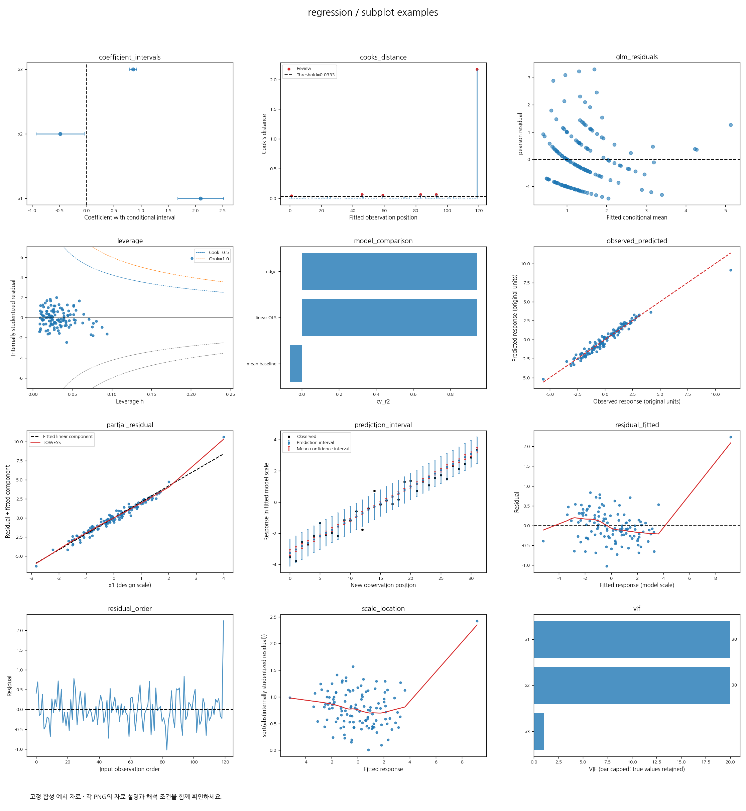

| 모듈·기능 | 개별 PNG |
| --- | --- |
| [`regression.coefficient_intervals`](../src/Visualization/regression/coefficient_intervals.py) — 회귀계수·t·p·신뢰구간 | [기본 이미지](images/visualization/regression/coefficient_intervals.png) |
| [`regression.cooks_distance`](../src/Visualization/regression/cooks_distance.py) — Cook 관측 영향력과 명시 기준 | [기본 이미지](images/visualization/regression/cooks_distance.png) |
| [`regression.glm_residuals`](../src/Visualization/regression/glm_residuals.py) — 분포별 GLM 적합평균과 Pearson/deviance 잔차 | [기본 이미지](images/visualization/regression/glm_residuals.png) · [logistic_pearson](images/visualization/regression/glm_residuals__logistic_pearson.png) · [logistic_deviance](images/visualization/regression/glm_residuals__logistic_deviance.png) · [poisson_deviance](images/visualization/regression/glm_residuals__poisson_deviance.png) · [gamma_pearson](images/visualization/regression/glm_residuals__gamma_pearson.png) · [gamma_deviance](images/visualization/regression/glm_residuals__gamma_deviance.png) |
| [`regression.leverage`](../src/Visualization/regression/leverage.py) — leverage·studentized 잔차·Cook 등고선 | [기본 이미지](images/visualization/regression/leverage.png) |
| [`regression.model_comparison`](../src/Visualization/regression/model_comparison.py) — 기준·전처리·대안 회귀의 검증 점수 비교 | [기본 이미지](images/visualization/regression/model_comparison.png) |
| [`regression.observed_predicted`](../src/Visualization/regression/observed_predicted.py) — 원 단위 관측–예측과 R²·RMSE | [기본 이미지](images/visualization/regression/observed_predicted.png) |
| [`regression.partial_residual`](../src/Visualization/regression/partial_residual.py) — Feature별 component-plus-residual 선형성 탐색 | [기본 이미지](images/visualization/regression/partial_residual.png) |
| [`regression.prediction_interval`](../src/Visualization/regression/prediction_interval.py) — 평균 CI와 새 관측 PI의 분리 표시 | [기본 이미지](images/visualization/regression/prediction_interval.png) |
| [`regression.residual_fitted`](../src/Visualization/regression/residual_fitted.py) — 잔차–적합값의 곡률·등분산 탐색 | [기본 이미지](images/visualization/regression/residual_fitted.png) |
| [`regression.residual_order`](../src/Visualization/regression/residual_order.py) — 잔차 관측/시간 순서 탐색 | [기본 이미지](images/visualization/regression/residual_order.png) |
| [`regression.scale_location`](../src/Visualization/regression/scale_location.py) — 표준화 잔차 산포의 scale-location | [기본 이미지](images/visualization/regression/scale_location.png) |
| [`regression.vif`](../src/Visualization/regression/vif.py) — 공선성 VIF와 표시 상한 | [기본 이미지](images/visualization/regression/vif.png) |

## relationships

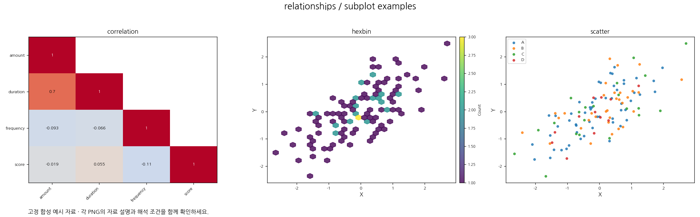

| 모듈·기능 | 개별 PNG |
| --- | --- |
| [`relationships.correlation`](../src/Visualization/relationships/correlation.py) — 강한 중복 Feature와 보정 유의성 조건을 함께 검토합니다. | [기본 이미지](images/visualization/relationships/correlation.png) |
| [`relationships.hexbin`](../src/Visualization/relationships/hexbin.py) — 대량 관측에서 겹침을 줄여 집중 영역과 희소 영역을 비교합니다. | [기본 이미지](images/visualization/relationships/hexbin.png) |
| [`relationships.scatter`](../src/Visualization/relationships/scatter.py) — 비선형 패턴·군집·이상 관측과 집단별 차이를 확인합니다. | [기본 이미지](images/visualization/relationships/scatter.png) |

## selection

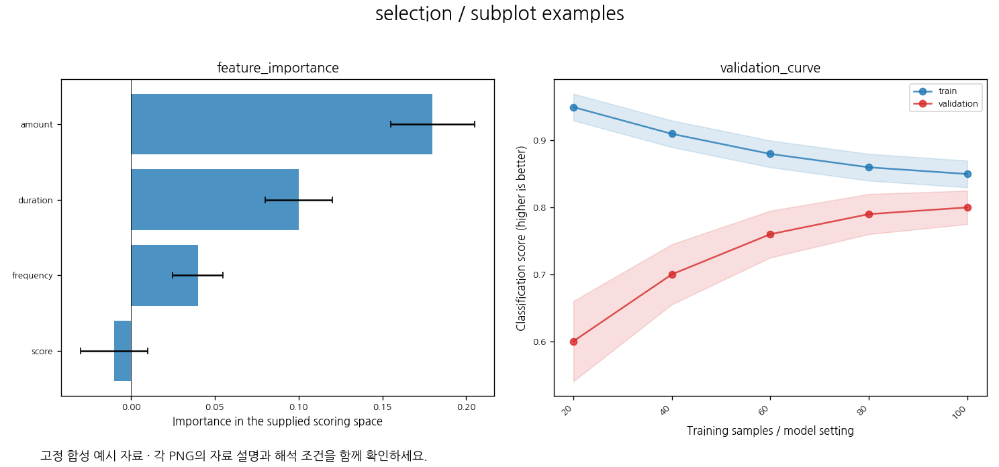

| 모듈·기능 | 개별 PNG |
| --- | --- |
| [`selection.feature_importance`](../src/Visualization/selection/feature_importance.py) — 동일 평가 기준의 Feature 중요도와 반복 변동을 비교해 검토 우선순위를 정합니다. | [기본 이미지](images/visualization/selection/feature_importance.png) |
| [`selection.validation_curve`](../src/Visualization/selection/validation_curve.py) — 학습량/분류 설정 변화의 train–validation 차이로 과적합과 개선 여지를 검토합니다. | [기본 이미지](images/visualization/selection/validation_curve.png) |

## time_series

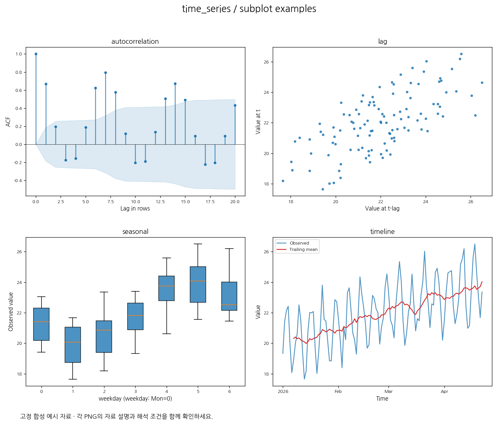

| 모듈·기능 | 개별 PNG |
| --- | --- |
| [`time_series.autocorrelation`](../src/Visualization/time_series/autocorrelation.py) — 시간 의존성과 계절 지연 후보를 탐색합니다. | [기본 이미지](images/visualization/time_series/autocorrelation.png) |
| [`time_series.lag`](../src/Visualization/time_series/lag.py) — 지연 관계·비선형 반복 패턴을 확인합니다. | [기본 이미지](images/visualization/time_series/lag.png) |
| [`time_series.seasonal`](../src/Visualization/time_series/seasonal.py) — 요일·월·시간별 반복 구조와 수집 불균형을 비교합니다. | [기본 이미지](images/visualization/time_series/seasonal.png) |
| [`time_series.timeline`](../src/Visualization/time_series/timeline.py) — 수준 변화·추세·수집 공백·관측 급변을 탐색합니다. | [기본 이미지](images/visualization/time_series/timeline.png) |

## 재현과 파일 계약

seed20261027의 합성 입력으로 네트워크 없이 생성합니다. 개별 이미지는1350×900px이며 PNG/manifest를 저장소에 함께 둡니다. Matplotlib 버전·렌더링 환경에 따라 픽셀이 달라질 수 있어 정확한 바이트 재현은 같은 의존성 환경에서 확인합니다.

`--check`는 manifest의61개 모듈과 현재 등록부의 완전 대응, PNG의 정상 디코딩·비어 있지 않은 픽셀·크기·해시, 추가/누락 파일을 검사합니다. 새 시각화를 등록하면 예제 입력과 PNG도 추가해야 합니다.
